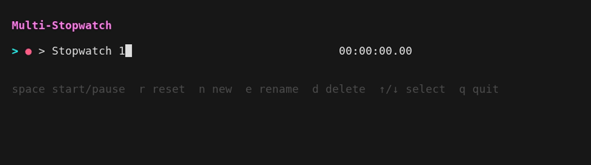

# multistop

A simple terminal app for running several named stopwatches at once.

Each stopwatch can be started, paused, reset, renamed or deleted on its own.
Times are shown as `HH:MM:SS.cc`, and a green or red dot shows whether each
one is running.




Stopwatches are not saved: everything is lost when you quit.

## Building

### With Home Manager

I install this in home manager, for which `nix/module.nix` provides a module:

```nix
{
  imports = [ /path/to/multistop/nix/module.nix ];
  programs.multistop.enable = true;
}
```

### With Go

Requires Go 1.24 or newer.

```sh
go build
./multistop
```

Or install it to `$GOBIN` (by default `~/go/bin`):

```sh
go install .
```

## Special Thanks to the Following Libraries

- [Bubble Tea](https://github.com/charmbracelet/bubbletea): TUI framework
- [Bubbles](https://github.com/charmbracelet/bubbles): text input
- [Lip Gloss](https://github.com/charmbracelet/lipgloss): styling

## License

MIT. See [LICENSE](LICENSE).
